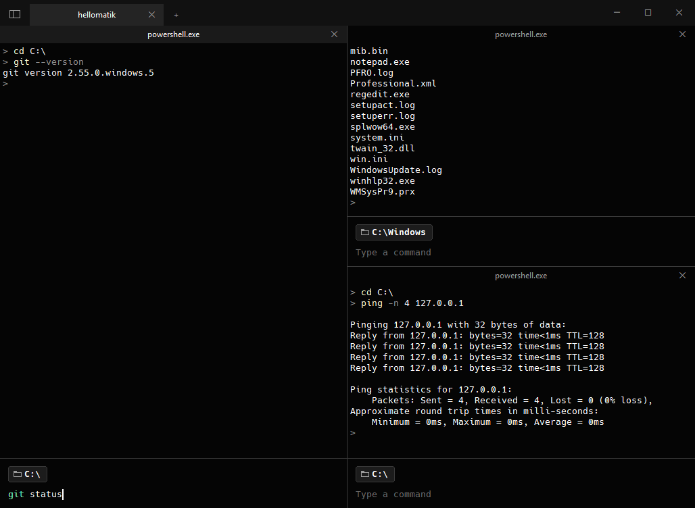
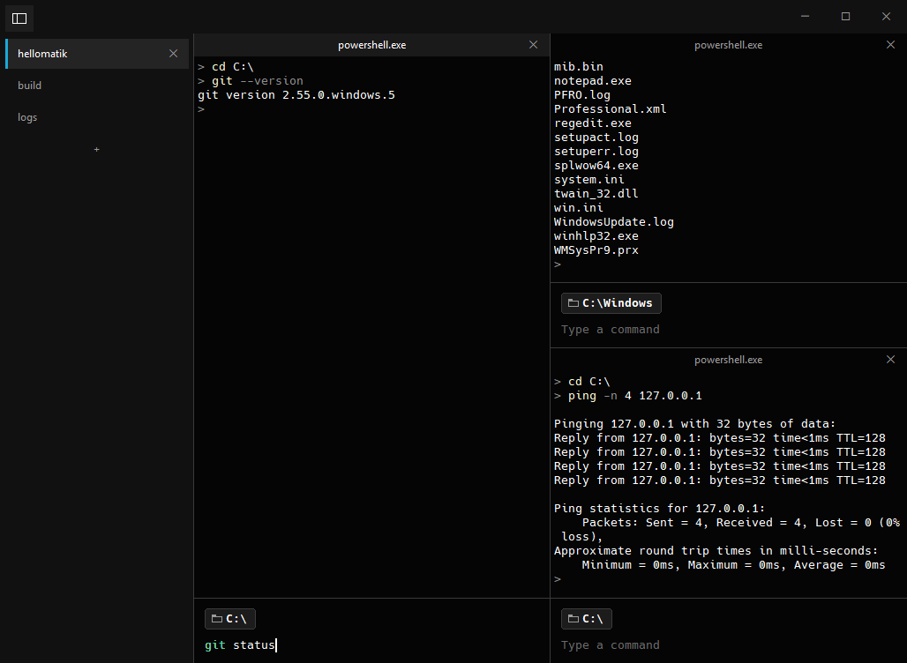

# warp-lite

A small, fast terminal for Windows with the look and shortcuts of [Warp](https://github.com/warpdotdev/warp) — and nothing else. No AI, no account, no telemetry. One ~5 MB `.exe` (Win32 + ConPTY + libvterm + GDI + DirectWrite).



## Features

- **Tabs and split panes** with Warp's shortcuts: `Ctrl+Shift+D` split right, `Ctrl+Shift+E` split down, `Ctrl+Alt+Arrows` move between panes, `Ctrl+Shift+T` new tab, `Ctrl+Shift+W` close.
- **Jump to any terminal** with `Ctrl+Shift+K`: every pane of every window, with what it's running and its folder; type to filter, `Enter` to go there. Tabs running Claude Code are named after their conversation.
- **Open Warp here** in the Explorer right-click menu (on a folder, a drive or inside a folder): a new tab opens already in that folder. On Windows 11 it's under *Show more options*.
- **Input box** at the bottom with the current folder (click it to switch folders), history, and the command coloured green if it exists or underlined in red if not.
- **Tab completion** like Warp's menu: commands, `-parameters` and paths (`↑/↓` or `Tab` to move, `Enter` to pick).
- **Picks up where you left off**: tabs, splits, folders and windows come back after a restart. Your last command is waiting in the input box, and anything that was still running (e.g. `ssh … tmux`) is relaunched. Claude Code and Codex resume the exact conversation each pane had (`claude --resume <id>`, `codex resume <id>`), even with several of them open in the same folder, instead of starting a new one.
- **Reconnects dropped ssh sessions**: when the connection drops (`client_loop: send disconnect: Connection reset`, `closed by remote host`…), `ssh host` or `ssh -t host "tmux new -A -s x"` (also `tmux attach`, `screen -R`) is launched again by itself after 2, 4, 8, 16 and then every 30 s, sooner when the network comes back, until it connects. A small card shows the attempt; `Esc` or typing cancels. A normal exit, a tmux detach or an authentication error never retries, and neither do other remote commands.
- **Vertical tabs**, renamable and hideable tabs, drag tabs to reorder them, several windows (drag a tab out to open it in a new one).
- `Ctrl+F` search, `Ctrl+click` links and file paths (also when wrapped over several lines, quoted or not, with `:line` behind): files open with their app, folders in Explorer, and programs and scripts are only shown selected in Explorer, never run. Drop files to paste their path, `Ctrl +/-` zoom.
- `Ctrl+C` copies the selection; text copied inside tmux/vim over SSH reaches the Windows clipboard (OSC 52).
- Warp's dark theme and font (Hack 13 px), with Nerd Font icons and symbol fallback built in. Emoji in color, and box drawing, blocks and powerline separators drawn over the whole cell like Windows Terminal does, so boxes and tables join up whatever the font.
- **Choose the font** by right-clicking the title bar: Hack, Cascadia Mono, Consolas, JetBrains Mono, Fira Code and other Google Fonts (downloaded once, the first time you pick them), or any other monospaced font you have installed. It changes in every window at once. The same menu has the **font size** (of that window) and the **text brightness** (from #AAAAAA to white; #DDDDDD by default, #CCCCCC is Windows Terminal's), which also changes in every window.
- Light on CPU: only the rows that change are redrawn.



## Install

Download `warp-lite-setup.exe` from [Releases](https://github.com/justdiegocom/warp-lite/releases/latest) and run it (per-user, no admin). It shows up as **Warp** in the Start menu and in *Installed apps*. Right-click the title bar for the language, *Start with Windows*, *Check for updates* and *Update automatically*.

**Updates:** Warp checks this repo's latest release at startup and every 6 hours. With *Update automatically* (on by default) the new installer is downloaded, verified against the release's SHA-256 and installed in the background; a small notice offers *Restart* when it's ready. Otherwise the notice offers *Install*. It never restarts on its own.

## Build

```sh
tools/build.sh          # cross-compiles with zig (x86_64-windows-gnu) → dist/
```

On Windows: `tools/build.ps1`.

## License

Third-party: libvterm (MIT), Hack (MIT / Bitstream Vera), Symbols Nerd Font (MIT). No Warp code is used; only its shortcuts, colours and default font are replicated.
